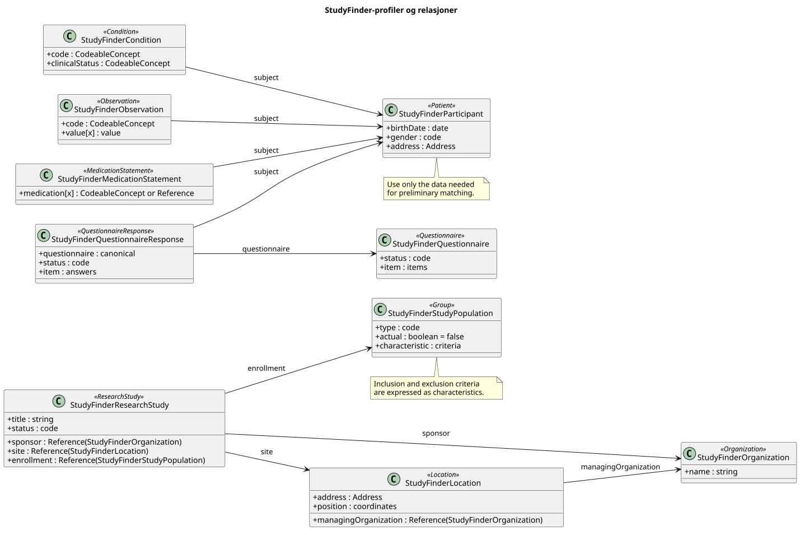

# Home - Forskningsstudier for deltakere v0.1.0

* [**Table of Contents**](toc.md)
* **Home**

## Home

| | |
| :--- | :--- |
| *Official URL*:http://hl7.no/fhir/ig/studyfinder/ImplementationGuide/hl7.fhir.no.studyfinder | *Version*:0.1.0 |
| Draft as of 2026-11-09 | *Computable Name*:StudyFinder |

### Forskningsstudier for deltakere

Denne implementasjonsguiden beskriver hvordan informasjon om forskningsstudier og potensielle deltakere kan representeres med HL7 FHIR R4. Målet er å gjøre det enklere for en person å finne studier som kan passe ut fra opplysninger som alder, bosted, helsetilstand og legemiddelbruk.

Guiden er rettet mot systemer som publiserer eller formidler studier, og tjenester som lar personer utforske aktuelle studier. Den standardiserer utveksling av data; den definerer ikke en bestemt portal eller en komplett rekrutteringsprosess.

#### Omfang

Første versjon av guiden beskriver:

* hvordan en forskningsstudie og studiested kan beskrives
* hvordan målgrupper og strukturerte inklusjons- og eksklusjonskriterier kan uttrykkes
* hvilke personopplysninger en tjeneste kan bruke for en foreløpig vurdering av kriteriene
* hvordan relevante studier kan presenteres, inkludert studiested og eventuell kompensasjon når slik informasjon er tilgjengelig

Guiden avgjør ikke om en person er endelig kvalifisert til å delta. Det er studieansvarlig som vurderer dette. Informasjon om kompensasjon er ikke et obligatorisk FHIR R4-felt i denne modellen og må avtales og beskrives særskilt før den standardiseres.

#### FHIR-ressurser

| | |
| :--- | :--- |
| `ResearchStudy` | Beskriver studiens tittel, status, formål, sponsor, periode og tilknyttede steder. |
| `Organization` | Beskriver en organisasjon som er studiested, sponsor eller ansvarlig aktør. |
| `Location` | Kan beskrive et konkret fysisk studiested med adresse og geografisk informasjon. |
| `Group` | Beskriver målgruppen for studien. I FHIR R4 kan strukturerte kriterier uttrykkes med gruppens`characteristic`-elementer, blant annet alder og helsetilstand. |
| `Patient` | Kan representere personen når det er nødvendig å utveksle personopplysninger i FHIR. En søketjeneste bør ikke opprette eller lagre en varig pasientressurs uten et reelt behov og gyldig grunnlag. |
| `Condition`,`Observation`og`MedicationStatement` | Kan uttrykke henholdsvis helsetilstander, relevante målinger og legemiddelbruk når disse opplysningene trengs for vurderingen. |
| `Questionnaire`og`QuestionnaireResponse` | Kan brukes til å innhente opplysninger fra personen på en strukturert måte. |

I FHIR R4 peker `ResearchStudy.site` på en `Location`. Et fysisk sted kan knyttes til organisasjonen via `Location.managingOrganization`. `ResearchStudy.location` er en kodebar beskrivelse, ikke en referanse til en `Location`-ressurs.

##### Ressursrelasjoner

Figuren viser StudyFinder-profilene som er definert i guiden, hvilken FHIR-ressurs hver profil bygger på, og relasjonene mellom dem.



#### Foreløpig vurdering av kriterier

En søketjeneste kan sammenligne strukturerte studiekriterier med opplysninger personen selv har gitt. Resultatet bør vise hvilke kriterier som ser ut til å være oppfylt, ikke oppfylt eller uavklart fordi det mangler informasjon. Uavklart skal ikke tolkes som kvalifisert.

En samlet prosentvis «match» er ikke definert av FHIR og må ikke presenteres som sannsynligheten for at studieansvarlig godkjenner deltakelse. Tjenesten bør vise at vurderingen er foreløpig og la personen se hvilke opplysninger og kriterier den bygger på.

#### Brukstilfeller

##### Publisere en studie

En studieansvarlig registrerer en rekrutterende studie med beskrivelse, målgruppe, strukturerte kriterier, sponsor og ett eller flere studiesteder.

##### Finne studier som kan passe

En person oppgir nødvendige opplysninger, for eksempel alder, bosted, helsetilstander og legemiddelbruk. Tjenesten viser studier med en forståelig vurdering av hvert kriterium. Avstand beregnes av tjenesten ut fra personens valgte geografiske område og studiestedets adresse eller koordinater; avstandsberegning er ikke definert av FHIR.

##### Friske frivillige

En studie kan angi at den søker friske frivillige. Tjenesten må skille dette fra manglende helseopplysninger: fravær av registrerte tilstander er ikke i seg selv dokumentasjon på at personen er frisk.

#### Personvern

Helseopplysninger er sensitive personopplysninger. Tjenester som bruker denne guiden bør begrense innsamling og lagring til det som er nødvendig, forklare formålet tydelig og ikke sende personens opplysninger til studier eller studieansvarlige uten et eget grunnlag og nødvendig informasjon til personen.


## Resource Content

```json
{
  "resourceType" : "ImplementationGuide",
  "id" : "hl7.fhir.no.studyfinder",
  "url" : "http://hl7.no/fhir/ig/studyfinder/ImplementationGuide/hl7.fhir.no.studyfinder",
  "version" : "0.1.0",
  "name" : "StudyFinder",
  "title" : "Forskningsstudier for deltakere",
  "status" : "draft",
  "date" : "2026-11-09T12:54:59+00:00",
  "publisher" : "HL7 Norge",
  "contact" : [{
    "name" : "HL7 Norge",
    "telecom" : [{
      "system" : "url",
      "value" : "https://www.hl7.no"
    }]
  }],
  "description" : "Implementasjonsguide for utveksling av informasjon om forskningsstudier, målgrupper og foreløpig vurdering av deltakelse.",
  "jurisdiction" : [{
    "coding" : [{
      "system" : "urn:iso:std:iso:3166",
      "code" : "NO",
      "display" : "Norway"
    }]
  }],
  "packageId" : "hl7.fhir.no.studyfinder",
  "license" : "CC0-1.0",
  "fhirVersion" : ["4.0.1"],
  "dependsOn" : [{
    "id" : "hl7tx",
    "extension" : [{
      "url" : "http://hl7.org/fhir/tools/StructureDefinition/implementationguide-dependency-comment",
      "valueMarkdown" : "Automatically added as a dependency - all IGs depend on HL7 Terminology"
    }],
    "uri" : "http://terminology.hl7.org/ImplementationGuide/hl7.terminology",
    "packageId" : "hl7.terminology.r4",
    "version" : "7.5.0"
  },
  {
    "id" : "hl7ext",
    "extension" : [{
      "url" : "http://hl7.org/fhir/tools/StructureDefinition/implementationguide-dependency-comment",
      "valueMarkdown" : "Automatically added as a dependency - all IGs depend on the HL7 Extension Pack"
    }],
    "uri" : "http://hl7.org/fhir/extensions/ImplementationGuide/hl7.fhir.uv.extensions",
    "packageId" : "hl7.fhir.uv.extensions.r4",
    "version" : "5.4.0"
  },
  {
    "id" : "hl7_fhir_no_basis",
    "uri" : "http://fhir.org/packages/hl7.fhir.no.basis/ImplementationGuide/hl7.fhir.no.basis",
    "packageId" : "hl7.fhir.no.basis",
    "version" : "2.2.2"
  }],
  "definition" : {
    "extension" : [{
      "url" : "http://hl7.org/fhir/tools/StructureDefinition/ig-internal-dependency",
      "valueCode" : "hl7.fhir.uv.tools.r4#1.3.0"
    },
    {
      "extension" : [{
        "url" : "code",
        "valueCode" : "copyrightyear"
      },
      {
        "url" : "value",
        "valueString" : "2026+"
      }],
      "url" : "http://hl7.org/fhir/tools/StructureDefinition/ig-parameter"
    },
    {
      "extension" : [{
        "url" : "code",
        "valueCode" : "releaselabel"
      },
      {
        "url" : "value",
        "valueString" : "ci-build"
      }],
      "url" : "http://hl7.org/fhir/tools/StructureDefinition/ig-parameter"
    },
    {
      "extension" : [{
        "url" : "code",
        "valueCode" : "autoload-resources"
      },
      {
        "url" : "value",
        "valueString" : "true"
      }],
      "url" : "http://hl7.org/fhir/tools/StructureDefinition/ig-parameter"
    },
    {
      "extension" : [{
        "url" : "code",
        "valueCode" : "path-liquid"
      },
      {
        "url" : "value",
        "valueString" : "template/liquid"
      }],
      "url" : "http://hl7.org/fhir/tools/StructureDefinition/ig-parameter"
    },
    {
      "extension" : [{
        "url" : "code",
        "valueCode" : "path-liquid"
      },
      {
        "url" : "value",
        "valueString" : "input/liquid"
      }],
      "url" : "http://hl7.org/fhir/tools/StructureDefinition/ig-parameter"
    },
    {
      "extension" : [{
        "url" : "code",
        "valueCode" : "path-qa"
      },
      {
        "url" : "value",
        "valueString" : "temp/qa"
      }],
      "url" : "http://hl7.org/fhir/tools/StructureDefinition/ig-parameter"
    },
    {
      "extension" : [{
        "url" : "code",
        "valueCode" : "path-temp"
      },
      {
        "url" : "value",
        "valueString" : "temp/pages"
      }],
      "url" : "http://hl7.org/fhir/tools/StructureDefinition/ig-parameter"
    },
    {
      "extension" : [{
        "url" : "code",
        "valueCode" : "path-output"
      },
      {
        "url" : "value",
        "valueString" : "output"
      }],
      "url" : "http://hl7.org/fhir/tools/StructureDefinition/ig-parameter"
    },
    {
      "extension" : [{
        "url" : "code",
        "valueCode" : "path-suppressed-warnings"
      },
      {
        "url" : "value",
        "valueString" : "input/ignoreWarnings.txt"
      }],
      "url" : "http://hl7.org/fhir/tools/StructureDefinition/ig-parameter"
    },
    {
      "extension" : [{
        "url" : "code",
        "valueCode" : "path-history"
      },
      {
        "url" : "value",
        "valueString" : "http://hl7.no/fhir/ig/studyfinder/history.html"
      }],
      "url" : "http://hl7.org/fhir/tools/StructureDefinition/ig-parameter"
    },
    {
      "extension" : [{
        "url" : "code",
        "valueCode" : "template-html"
      },
      {
        "url" : "value",
        "valueString" : "template-page.html"
      }],
      "url" : "http://hl7.org/fhir/tools/StructureDefinition/ig-parameter"
    },
    {
      "extension" : [{
        "url" : "code",
        "valueCode" : "template-md"
      },
      {
        "url" : "value",
        "valueString" : "template-page-md.html"
      }],
      "url" : "http://hl7.org/fhir/tools/StructureDefinition/ig-parameter"
    },
    {
      "extension" : [{
        "url" : "code",
        "valueCode" : "apply-contact"
      },
      {
        "url" : "value",
        "valueString" : "true"
      }],
      "url" : "http://hl7.org/fhir/tools/StructureDefinition/ig-parameter"
    },
    {
      "extension" : [{
        "url" : "code",
        "valueCode" : "apply-context"
      },
      {
        "url" : "value",
        "valueString" : "true"
      }],
      "url" : "http://hl7.org/fhir/tools/StructureDefinition/ig-parameter"
    },
    {
      "extension" : [{
        "url" : "code",
        "valueCode" : "apply-copyright"
      },
      {
        "url" : "value",
        "valueString" : "true"
      }],
      "url" : "http://hl7.org/fhir/tools/StructureDefinition/ig-parameter"
    },
    {
      "extension" : [{
        "url" : "code",
        "valueCode" : "apply-jurisdiction"
      },
      {
        "url" : "value",
        "valueString" : "true"
      }],
      "url" : "http://hl7.org/fhir/tools/StructureDefinition/ig-parameter"
    },
    {
      "extension" : [{
        "url" : "code",
        "valueCode" : "apply-license"
      },
      {
        "url" : "value",
        "valueString" : "true"
      }],
      "url" : "http://hl7.org/fhir/tools/StructureDefinition/ig-parameter"
    },
    {
      "extension" : [{
        "url" : "code",
        "valueCode" : "apply-publisher"
      },
      {
        "url" : "value",
        "valueString" : "true"
      }],
      "url" : "http://hl7.org/fhir/tools/StructureDefinition/ig-parameter"
    },
    {
      "extension" : [{
        "url" : "code",
        "valueCode" : "apply-version"
      },
      {
        "url" : "value",
        "valueString" : "true"
      }],
      "url" : "http://hl7.org/fhir/tools/StructureDefinition/ig-parameter"
    },
    {
      "extension" : [{
        "url" : "code",
        "valueCode" : "apply-wg"
      },
      {
        "url" : "value",
        "valueString" : "true"
      }],
      "url" : "http://hl7.org/fhir/tools/StructureDefinition/ig-parameter"
    },
    {
      "extension" : [{
        "url" : "code",
        "valueCode" : "active-tables"
      },
      {
        "url" : "value",
        "valueString" : "true"
      }],
      "url" : "http://hl7.org/fhir/tools/StructureDefinition/ig-parameter"
    },
    {
      "extension" : [{
        "url" : "code",
        "valueCode" : "fmm-definition"
      },
      {
        "url" : "value",
        "valueString" : "http://hl7.org/fhir/versions.html#maturity"
      }],
      "url" : "http://hl7.org/fhir/tools/StructureDefinition/ig-parameter"
    },
    {
      "extension" : [{
        "url" : "code",
        "valueCode" : "propagate-status"
      },
      {
        "url" : "value",
        "valueString" : "true"
      }],
      "url" : "http://hl7.org/fhir/tools/StructureDefinition/ig-parameter"
    },
    {
      "extension" : [{
        "url" : "code",
        "valueCode" : "excludelogbinaryformat"
      },
      {
        "url" : "value",
        "valueString" : "true"
      }],
      "url" : "http://hl7.org/fhir/tools/StructureDefinition/ig-parameter"
    },
    {
      "extension" : [{
        "url" : "code",
        "valueCode" : "tabbed-snapshots"
      },
      {
        "url" : "value",
        "valueString" : "true"
      }],
      "url" : "http://hl7.org/fhir/tools/StructureDefinition/ig-parameter"
    }],
    "resource" : [{
      "extension" : [{
        "url" : "http://hl7.org/fhir/tools/StructureDefinition/resource-information",
        "valueString" : "StructureDefinition:resource"
      },
      {
        "url" : "http://hl7.org/fhir/StructureDefinition/implementationguide-page",
        "valueUri" : "StructureDefinition-studyfinder-research-study.html"
      }],
      "reference" : {
        "reference" : "StructureDefinition/studyfinder-research-study"
      },
      "name" : "Forskningsstudie for studiefinning",
      "description" : "Forskningsstudie som kan vises for personer som leter etter studier de kan være aktuelle for.",
      "exampleBoolean" : false
    },
    {
      "extension" : [{
        "url" : "http://hl7.org/fhir/tools/StructureDefinition/resource-information",
        "valueString" : "StructureDefinition:resource"
      },
      {
        "url" : "http://hl7.org/fhir/StructureDefinition/implementationguide-page",
        "valueUri" : "StructureDefinition-studyfinder-location.html"
      }],
      "reference" : {
        "reference" : "StructureDefinition/studyfinder-location"
      },
      "name" : "Fysisk studiested",
      "description" : "Fysisk studiested med adresse og eventuell geografisk posisjon.",
      "exampleBoolean" : false
    },
    {
      "extension" : [{
        "url" : "http://hl7.org/fhir/tools/StructureDefinition/resource-information",
        "valueString" : "StructureDefinition:resource"
      },
      {
        "url" : "http://hl7.org/fhir/StructureDefinition/implementationguide-page",
        "valueUri" : "StructureDefinition-studyfinder-condition.html"
      }],
      "reference" : {
        "reference" : "StructureDefinition/studyfinder-condition"
      },
      "name" : "Helsetilstand for vurdering mot studiekriterier",
      "description" : "Helsetilstand som kan være relevant for inklusjons- eller eksklusjonskriterier.",
      "exampleBoolean" : false
    },
    {
      "extension" : [{
        "url" : "http://hl7.org/fhir/tools/StructureDefinition/resource-information",
        "valueString" : "StructureDefinition:resource"
      },
      {
        "url" : "http://hl7.org/fhir/StructureDefinition/implementationguide-page",
        "valueUri" : "StructureDefinition-studyfinder-medication-statement.html"
      }],
      "reference" : {
        "reference" : "StructureDefinition/studyfinder-medication-statement"
      },
      "name" : "Legemiddelbruk for vurdering mot studiekriterier",
      "description" : "Legemiddelbruk som kan være relevant for inklusjons- eller eksklusjonskriterier.",
      "exampleBoolean" : false
    },
    {
      "extension" : [{
        "url" : "http://hl7.org/fhir/tools/StructureDefinition/resource-information",
        "valueString" : "StructureDefinition:resource"
      },
      {
        "url" : "http://hl7.org/fhir/StructureDefinition/implementationguide-page",
        "valueUri" : "StructureDefinition-studyfinder-study-population.html"
      }],
      "reference" : {
        "reference" : "StructureDefinition/studyfinder-study-population"
      },
      "name" : "Målgruppe for forskningsstudie",
      "description" : "Definisjon av målgruppen og strukturerte inklusjons- og eksklusjonskriterier for en forskningsstudie.",
      "exampleBoolean" : false
    },
    {
      "extension" : [{
        "url" : "http://hl7.org/fhir/tools/StructureDefinition/resource-information",
        "valueString" : "StructureDefinition:resource"
      },
      {
        "url" : "http://hl7.org/fhir/StructureDefinition/implementationguide-page",
        "valueUri" : "StructureDefinition-studyfinder-observation.html"
      }],
      "reference" : {
        "reference" : "StructureDefinition/studyfinder-observation"
      },
      "name" : "Måling for vurdering mot studiekriterier",
      "description" : "Måling eller klinisk observasjon som kan være relevant for studiekriterier.",
      "exampleBoolean" : false
    },
    {
      "extension" : [{
        "url" : "http://hl7.org/fhir/tools/StructureDefinition/resource-information",
        "valueString" : "StructureDefinition:resource"
      },
      {
        "url" : "http://hl7.org/fhir/StructureDefinition/implementationguide-page",
        "valueUri" : "StructureDefinition-studyfinder-organization.html"
      }],
      "reference" : {
        "reference" : "StructureDefinition/studyfinder-organization"
      },
      "name" : "Organisasjon for forskningsstudie",
      "description" : "Sponsor, ansvarlig organisasjon eller organisasjon som er studiested.",
      "exampleBoolean" : false
    },
    {
      "extension" : [{
        "url" : "http://hl7.org/fhir/tools/StructureDefinition/resource-information",
        "valueString" : "StructureDefinition:resource"
      },
      {
        "url" : "http://hl7.org/fhir/StructureDefinition/implementationguide-page",
        "valueUri" : "StructureDefinition-studyfinder-participant.html"
      }],
      "reference" : {
        "reference" : "StructureDefinition/studyfinder-participant"
      },
      "name" : "Potensiell studiedeltaker",
      "description" : "Personopplysninger som kan brukes ved en foreløpig vurdering mot studiekriterier.",
      "exampleBoolean" : false
    },
    {
      "extension" : [{
        "url" : "http://hl7.org/fhir/tools/StructureDefinition/resource-information",
        "valueString" : "StructureDefinition:resource"
      },
      {
        "url" : "http://hl7.org/fhir/StructureDefinition/implementationguide-page",
        "valueUri" : "StructureDefinition-studyfinder-questionnaire.html"
      }],
      "reference" : {
        "reference" : "StructureDefinition/studyfinder-questionnaire"
      },
      "name" : "Spørreskjema for studiesøk",
      "description" : "Spørreskjema for strukturert innhenting av nødvendige opplysninger fra en person som leter etter studier.",
      "exampleBoolean" : false
    },
    {
      "extension" : [{
        "url" : "http://hl7.org/fhir/tools/StructureDefinition/resource-information",
        "valueString" : "StructureDefinition:resource"
      },
      {
        "url" : "http://hl7.org/fhir/StructureDefinition/implementationguide-page",
        "valueUri" : "StructureDefinition-studyfinder-questionnaire-response.html"
      }],
      "reference" : {
        "reference" : "StructureDefinition/studyfinder-questionnaire-response"
      },
      "name" : "Svar på spørreskjema for studiesøk",
      "description" : "Strukturerte opplysninger fra en person som leter etter studier.",
      "exampleBoolean" : false
    }],
    "page" : {
      "extension" : [{
        "url" : "http://hl7.org/fhir/tools/StructureDefinition/ig-page-name",
        "valueUrl" : "toc.html"
      }],
      "nameUrl" : "toc.html",
      "title" : "Table of Contents",
      "generation" : "html",
      "page" : [{
        "extension" : [{
          "url" : "http://hl7.org/fhir/tools/StructureDefinition/ig-page-name",
          "valueUrl" : "index.html"
        }],
        "nameUrl" : "index.html",
        "title" : "Home",
        "generation" : "markdown"
      }]
    },
    "parameter" : [{
      "code" : "path-resource",
      "value" : "input/capabilities"
    },
    {
      "code" : "path-resource",
      "value" : "input/examples"
    },
    {
      "code" : "path-resource",
      "value" : "input/extensions"
    },
    {
      "code" : "path-resource",
      "value" : "input/models"
    },
    {
      "code" : "path-resource",
      "value" : "input/operations"
    },
    {
      "code" : "path-resource",
      "value" : "input/profiles"
    },
    {
      "code" : "path-resource",
      "value" : "input/resources"
    },
    {
      "code" : "path-resource",
      "value" : "input/vocabulary"
    },
    {
      "code" : "path-resource",
      "value" : "input/maps"
    },
    {
      "code" : "path-resource",
      "value" : "input/testing"
    },
    {
      "code" : "path-resource",
      "value" : "input/history"
    },
    {
      "code" : "path-resource",
      "value" : "fsh-generated/resources"
    },
    {
      "code" : "path-pages",
      "value" : "template/config"
    },
    {
      "code" : "path-pages",
      "value" : "input/images"
    },
    {
      "code" : "path-tx-cache",
      "value" : "input-cache/txcache"
    }]
  }
}

```
